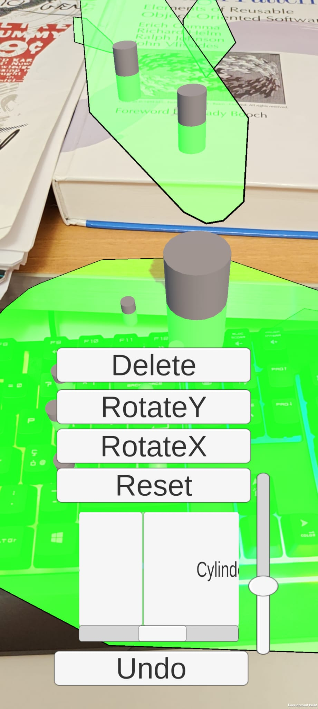
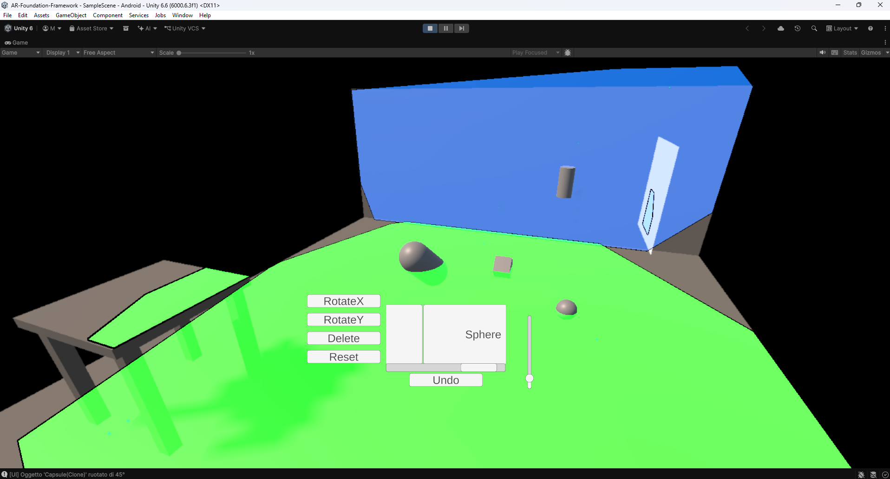
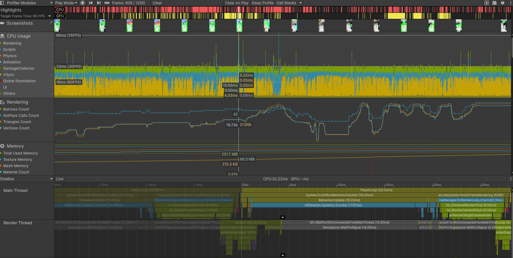
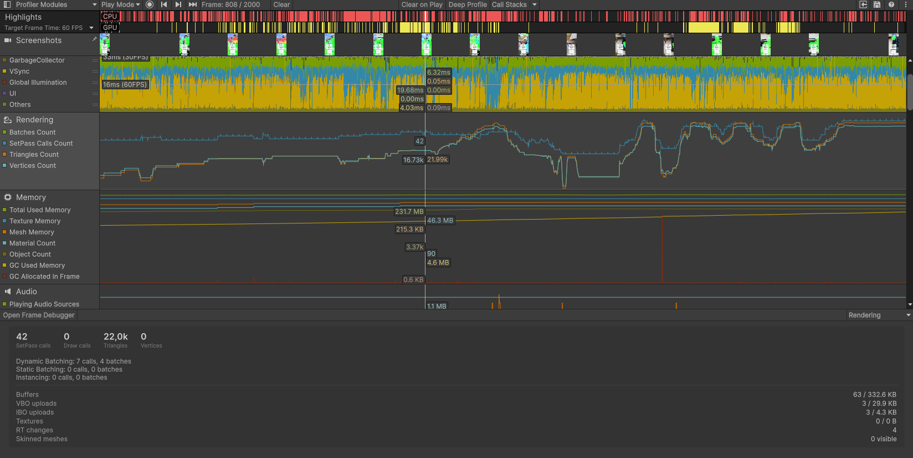
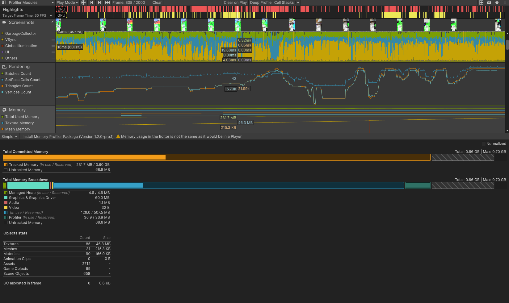
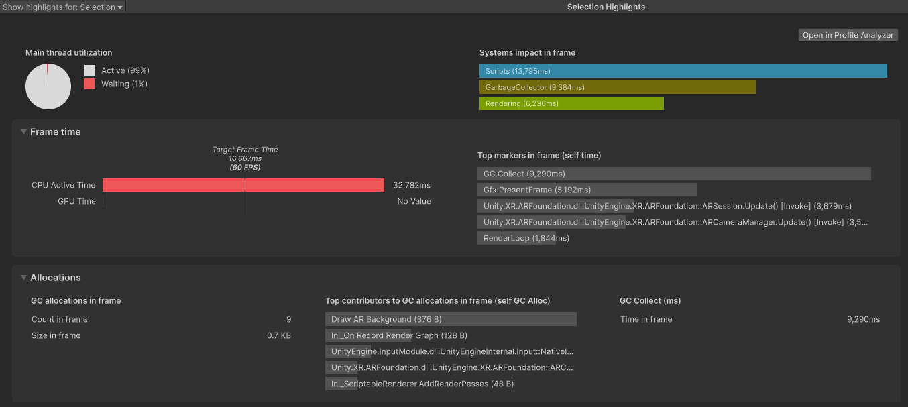
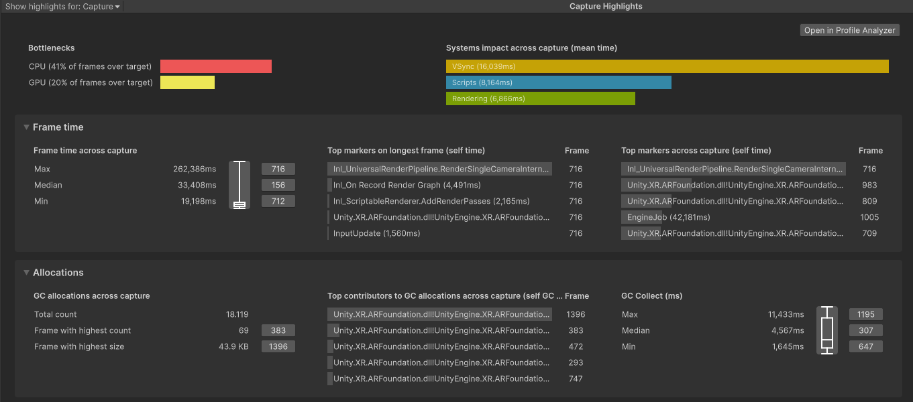

# AR-Foundation-Framework
For my university thesis, creating an AR App with AR Foundation framework in Unity with ARCore XR Plug-in installed and activated; it also works for iPhone, just install and activate the plugin.

> **N.B.:** Here is some information, the complete thesis is in the pdf, and I will also leave the whole folder, so all the various information will be mainly there.

> **N.B.:** Obviously the application does not work as well as in the Unity simulator, since in the latter everything is ideal: camera, floors, etc...

> **N.B.:** Obviously the application does not work as well as in the Unity simulator, since in the latter everything is ideal: camera, floors, etc...

---

    

---

---

This software is an **AR Markerless Video See-Through** app, in which you can spawn three-dimensional objects on flat horizontal, vertical, and inclined surfaces. You can interact with them by rotating, scaling, dragging and dropping, deleting, deleting all objects on the scene, and undoing commands. The UI is very simple: buttons allow the user to interact with them and perform various actions, a scroll view for selecting the object to spawn, and a slider for resizing the object.

It's all about Managers, and I've also created Custom Managers, which simply color the different planes differently (a horizontal plane will have a different color than a vertical one), and also when I drag, the plane where the object is located will be highlighted in red; a similar thing was done for point clouds.

# How I Did It
## Basic Initial Set-up to start
1. Create a 3D empty project in Unity Hub
2. Window > Package Management > Package Manager and then go in Unity Registry and install AR Foundation and Google ARCore.
3. Edit > Project Settings > XR Plug In Management and enable XR Simulator in Windows and in Android ARCore
4. Edit > Project Settings > Player in Android delete Vulkan because maybe cause bug in the mobile phone, like black screen.
5. In the project directory at the bottom, Assets > Settings and add in Mobile Renderer and PC Renderer the comonent "AR Background Renderer Feature"
6. Delete the current main camera and create with right click > XR > AR Session and XR Origin
7. Window > XR > AR Foundation > XR Enviroment to create and visualize a simulation of application
8. Then add what you want in XR Origin (ARManager,...) and if you want add script to manage the behaviour of managers
9. Create the various build that you want, File > Build Profiles for the various project builds

## Set Up Smartphone and connection to PC

1. You have to need installed and updated the "Google Play Services for AR", then you active the "developer account" by clicking ten or more times on the number of build in your system settings in your smartphone, then you have to enable de Debug USB.
2. then you connect your smartphone to your pc and enable the "file transmission" connection, then go to File > Build Profiles and in device click refresh until you see your device, then you click build o build and run, then import the apk file generated in an directory on your smartphone 

## Profiling
I use the built in **Unity Profiler**: i plug-in my phone into my pc with USB and always in Build Profiles i check the development option and then i click Build And Run and automatically Unity Profiler open and start the register session. Then when you stop the session remember to save in the top right. 

---

---

---

---

---

